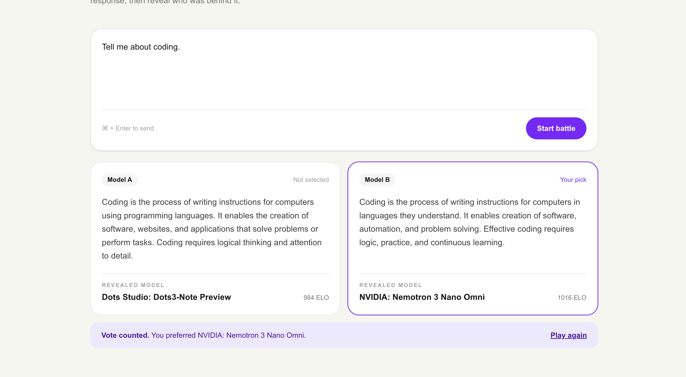

# Blindfold

Blind test LLMs. Vote, then see who won.

**Live demo:** https://blindfold-two.vercel.app



Blindfold is a blind-test arena for LLMs. You send a prompt, two anonymous models answer it, you vote for the better response, and only then are the models revealed. Every vote updates an ELO leaderboard, so over time you can see which model people actually prefer when brand names are hidden.

## Features

- Two randomly picked models answer the same prompt in parallel
- Model names stay hidden on the server until you vote
- Each match is stored, and one match accepts only one vote
- ELO ratings update after every vote
- Live leaderboard sorted by rating
- Model pool mixes Groq and OpenRouter free models; the free list is fetched live and cached for an hour

## Tech stack

- Next.js (App Router), React, TypeScript
- Tailwind CSS
- Node.js route handlers
- PostgreSQL on Neon, accessed with `pg`
- Groq and OpenRouter APIs (free tiers)
- Deployed on Vercel

## Getting started

Install dependencies:

```bash
npm install
```

Create a `.env.local` file in the project root:

```
GROQ_API_KEY=your_groq_api_key
OPENROUTER_API_KEY=your_openrouter_api_key
DATABASE_URL=your_postgres_connection_string
```

Create the tables in your Postgres database (for example in the Neon SQL Editor):

```sql
create table models (
  id text primary key,
  name text not null,
  elo double precision not null default 1000,
  games integer not null default 0
);

create table matches (
  id uuid primary key default gen_random_uuid(),
  prompt text not null,
  model_a text not null references models(id),
  model_b text not null references models(id),
  response_a text not null,
  response_b text not null,
  winner text check (winner in ('A', 'B')),
  created_at timestamptz not null default now()
);
```

Run the app:

```bash
npm run dev
```

Open http://localhost:3000.

## Project structure

```
app/
  api/battle/route.ts   picks two models, gets answers, stores the match
  api/vote/route.ts     records the vote, updates ELO, reveals model names
  leaderboard/          ELO leaderboard page
  how-it-works/         short explainer page
components/             Header, PromptBox, ModelCard, BattleArena
lib/
  models.ts             model pool and random pairing
  openrouter.ts         fetches the current free OpenRouter models
  llm.ts                calls Groq or OpenRouter and cleans up the answer
  elo.ts                ELO calculation
  db.ts                 Postgres connection pool
```

## How AI was used in this project

AI is part of the product itself: the app sends prompts to LLMs from Groq and OpenRouter and compares their answers.

I also used Claude while building it:

- **Idea and scope:** brainstorming project ideas and narrowing the blind model arena down to a version that could be finished quickly.
- **Architecture:** planning the request flow, the data model, and the ELO approach.
- **Coding:** generating the code step by step in small bits, which I ran and tested in the browser after each step.
- **Debugging:** fixing issues such as unreadable Markdown in model answers, a Next.js build error on the leaderboard page, and a broken `package.json`.
- **Documentation:** drafting the README.

The visual design was made by me in Figma, and I implemented it with Tailwind CSS.

## Notes

- The free tiers have rate limits (OpenRouter allows about 50 free requests per day), so battles may fail once the daily limit is reached.
- The free model list changes over time, so the model pool changes with it.
